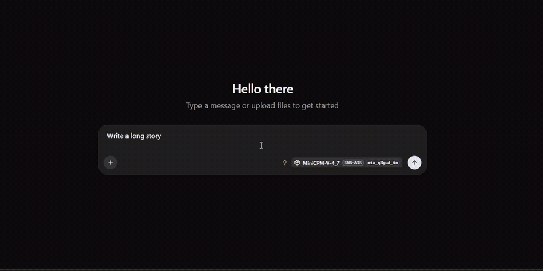
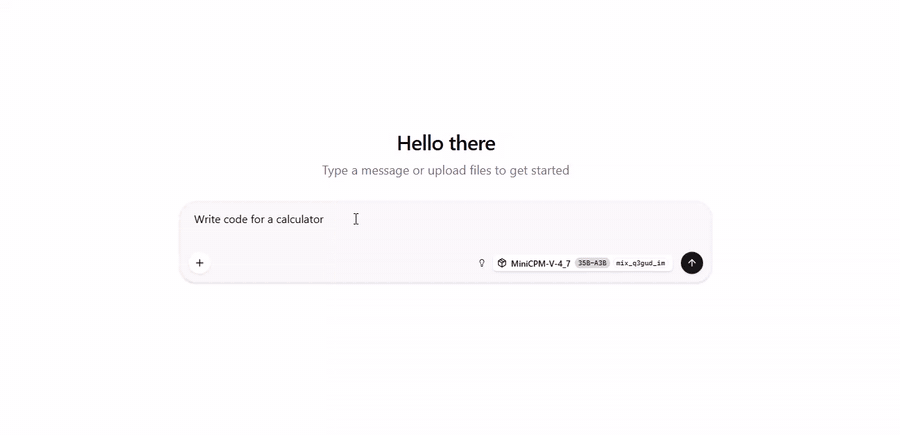
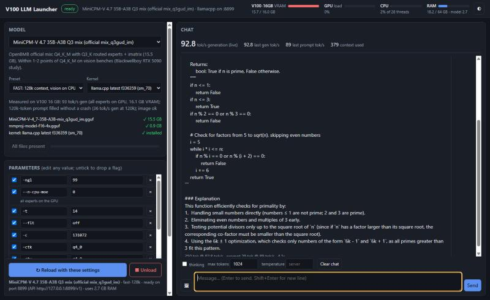

# V100-LLM

**One folder to run the best local LLMs on an NVIDIA Tesla V100 16 GB under Windows.** It includes a GUI to pick a model and
an engine ("kernel"), downloads anything that is missing, tunes every model for a 16 GB V100, gives each model a vision (image)
mode, and ships a test suite that scores models in a leaderboard.

You don't need WSL, Docker, CUDA, Visual Studio or Python: the folder brings its own engines, CUDA runtime and Python.

## 📱 Control your V100 from your Android phone and switch models

The **[phone app](phone-app/)** connects your Android phone to this PC through an encrypted Cloudflare tunnel (no port
forwarding), from anywhere:

| | |
|---|---|
| 🔀 **Switch models** | Every model of the catalog with its tuned presets: **Load**, **Switch**, **Reload** or **Unload** with one tap |
| 📊 **Live PC status** | Loaded model plus **VRAM, GPU load, CPU and RAM** bars at the top of every chat, refreshed every 3 s |
| 💬 **Chat** | Streaming replies, sessions, thinking view, tokens/s and context used; the model list follows what is loaded |
| 🖼️ **Vision & files** | Send photos, PDFs and PC screenshots to the vision models; browse and upload files on the PC |
| 🖥️ **Tools** | The model can run code, read files, search the web, draw charts and remember facts (you approve each action) |
| 🤖 **Code agent (beta)** | OpenCode working on a project folder of your PC with the loaded model |

**Get it:** install [`phone-app/release/LocalAI-Bridge-V100.apk`](phone-app/release/LocalAI-Bridge-V100.apk) (Android 8+),
run `phone-app\Start-Server.bat` on the PC (needs Python 3.10+), and scan the QR code it shows. The V100-LLM launcher is
started automatically when the phone needs it. Details: [phone-app/README.md](phone-app/README.md).

## Demo: MiniCPM-V 4.7 35B-A3B at ~90 tok/s on one V100 16 GB

Real-time screen recordings (not sped up) of the `fast-128k` preset: official OpenBMB `mix_q3gud_im` quant, stock llama.cpp,
128k context, vision enabled. The tokens/s counter under each reply is the chat app's own measurement.

| Long story (1,750 tokens) | Code (a calculator) |
|---|---|
|  |  |
| [▶ MP4 video](media/minicpm-v-93tps-story.mp4) | [▶ MP4 video](media/minicpm-v-93tps-code.mp4) |

**The GUI** (`START-GUI.bat`): pick a model, preset and engine, load or unload it, edit any parameter, chat with images, and watch live tok/s, VRAM, GPU load, CPU and RAM.



<!-- LEADERBOARD -->
## Leaderboard (hard suite v2)


72 tasks in 7 categories, every one graded by code (see [Evaluating models](#evaluating-models)). Scores are 0-100 per category, and Overall is the mean of the categories. Gen tok/s is the mean generation speed over replies of 64+ tokens; prompt tok/s is measured on short prompts. Every model runs with its recommended preset from `catalog.json`. Rebuild this table with `EVALUATE.bat`.

| # | Model | Kernel | Size (GB) | Context | Gen tok/s | Prompt tok/s (short) | Coding | Reasoning | Instructions | Web search | Agent | Vision | Long context | Overall |
|---|---|---|---|---|---|---|---|---|---|---|---|---|---|---|
| 1 | Qwen3.8-27B HauhauCS Aggressive IQ3_XS | fastmtp | 13.1 | 24k | 42.2 | 387 | 88 | 95 | 50 | 100 | 100 | 88 | 100 | **88.6** |
| 2 | MiniCPM-V 4.7 35B-A3B Q3 mix (official mix_q3gud_im) | llamacpp | 15.5 | 128k | 93.4 | 467 | 88 | 100 | 50 | 88 | 100 | 88 | 100 | **87.5** |
| 3 | MiniCPM-V 4.7 35B-A3B IQ3_XS | llamacpp | 14.5 | 262k | 41.4 | 476 | 94 | 100 | 42 | 88 | 100 | 88 | 100 | **87.2** |
| 4 | MiniCPM-V 4.7 35B-A3B Uncensored Q4_K-IQ4_XS (AtomicChat) | llamacpp | 20.1 | 262k | 38.3 | 376 | 88 | 100 | 33 | 100 | 100 | 88 | 100 | **86.9** |
| 5 | MiniCPM-V 4.7 35B-A3B CRACK Q4_K_M (dealignai) | llamacpp | 22.6 | 262k | 40.5 | 340 | 88 | 95 | 33 | 100 | 100 | 88 | 100 | **86.2** |
| 6 | Strata: Qwen3.8-Flash-Next 125B Q2_0 | strata | 66.4 | 262k | 34.8 | 1207 | 94 | 90 | 42 | 88 | 100 | 88 | 100 | **85.8** |
| 7 | Strata: Qwen3.8-Flash-Next 125B IQ2_XS | strata | 68.0 | 262k | 34.1 | 1163 | 88 | 100 | 50 | 88 | 100 | 75 | 100 | **85.7** |
| 8 | Strata: Qwen3.8-Flash-Next 125B Coder IQ1_M | strata | 58.4 | 262k | 29.7 | 1247 | 94 | 100 | 42 | 88 | 100 | 75 | 100 | **85.4** |
| 9 | NVIDIA Nemotron-3.5-Bolt-74B-A9B (2-bit) | llamacpp | 22.0 | 262k | 16.7 | 277 | 75 | 85 | 58 | 100 | 100 | 88 | 50 | **79.4** |
| 10 | Qwen3.8-27B HauhauCS Aggressive Q2_K_P (long context) | llamacpp | 10.7 | 160k | 41.6 | 326 | 75 | 95 | 42 | 100 | 100 | 88 | 50 | **78.5** |
| 11 | Ternary-Bonsai-2-27B Uncensored Heretic | prism | 7.2 | 262k | 39.5 | 363 | 56 | 100 | 42 | 100 | 100 | 88 | 50 | **76.5** |
| 12 | Underdog Saluki 27B (Qwen3.8 2-bit, MTP) | llamacpp | 8.3 | 262k | 46.8 | 351 | 62 | 95 | 42 | 88 | 100 | 88 | 50 | **74.9** |
| 13 | PXA-Fusion4-35B-A3B PXQ2 | pxa | 11.2 | 16k | 70.0 | 2384 | 38 | 90 | 25 | 88 | 100 | 75 | 100 | **73.6** |
| 14 | Qwen3.8-27B PXQ3 | pxa | 12.4 | 8k | 19.8 | 573 | 75 | 95 | 42 | 100 | 100 | 88 | 0 | **71.3** |
| 15 | Ornith-1.5-35B-A3B PXQ2 | pxa | 11.2 | 16k | 64.1 | 2333 | 50 | 85 | 33 | 100 | 83 | 75 | 0 | **60.9** |

Notes:
- Long context is a ~14k-token text with three facts hidden in different places that have to be combined. Qwen3.8-27B PXQ3 runs with an 8k context preset, so the text does not fit; Ornith runs with 16k and still answered wrong.
- Fusion4 and Ornith run without the model card's repetition penalties. With them they scored much lower, because the penalties corrupt numbers, code and tool calls (8080 became 80). The penalties are still available as the `creative` preset.
- **Fastest:** MiniCPM-V 4.7 Q3 mix runs at **93 tok/s with 128k context** on the 16 GB V100 (preset `fast-128k`): the vision encoder runs on the CPU, which frees enough VRAM to keep every expert on the GPU. A 120k-token prompt was filled without a crash (36 tok/s while generating at 120k).
- Strata runs three quantizations of the same 125B model (IQ2_XS, Q2_0 and the Coder IQ1_M with half the experts); they share one 28.8 GB n-gram table that is read from the SSD.
- MiniCPM-V CRACK with its DSpark draft model is slower on a 16 GB card (34 vs 38.5 tok/s): the drafter needs ~1.5 GB of VRAM, so 7 more layers of experts go to RAM, and chat drafts are accepted only ~47% of the time.
- ExLlamaV3 (Qwen3.8-27B EXL3) runs on the V100 but at ~11 tok/s, so it is not scored.
- The older, easier suite (v1) is still in `eval/results/`; most models scored 90-100 there, which is why v2 exists.
<!-- /LEADERBOARD -->

## Quick start

1. Install an NVIDIA driver from the **R576 series or newer**. A V100 in TCC mode is fine.
2. Download this repository (green **Code → Download ZIP**, or `git clone`), then extract it, for example to `D:\V100-LLM`.
3. Double-click **`START-GUI.bat`**. The first run downloads the portable Python runtime (37 MB), then opens the GUI at
   http://127.0.0.1:7860.
4. Pick a model, then press **Download missing**. That fetches the model files from Hugging Face (checking each one's
   checksum) and the engine from this repo's release.
5. Press **Start**, then chat in the right-hand panel. A live tokens/s meter, prompt speed and image upload are built in.
   Any OpenAI-compatible app can also use `http://127.0.0.1:8899/v1`.

Every parameter is editable in the GUI. **Recommended** restores the tuned values, and **Save .bat** writes a standalone
launcher for your own settings.

## Models (tested on one Tesla V100-SXM2-16GB, Xeon E5-2660 v4, 64 GB DDR4)

| Model | Engine | Size | Context | Speed (gen) | Full-context test | Vision | System RAM used | Best for |
|---|---|---|---|---|---|---|---|---|
| **MiniCPM-V 4.7 35B-A3B Q3 mix** (official mix_q3gud_im) | llama.cpp | 15.5 GB | **128k** / 262k | **93 tok/s** at 128k, 70 at 262k | 120k ✓ | CPU | ~2 GB (128k: all experts on GPU) | **best all-rounder** |
| **Qwen3.8-27B HauhauCS IQ3_XS** + FastMTP | FastMTP | 12.2 GB | 24k / 80k / 120k | 40-53 tok/s | 118k ✓ | GPU (80k) / CPU (120k) | ~2 GB | top score, uncensored |
| **MiniCPM-V 4.7 35B-A3B** IQ3_XS | llama.cpp | 14.5 GB | **262k** | 39-41 tok/s | 252k ✓ | GPU | ~3.5 GB (2.1 GB experts) | coding |
| MiniCPM-V 4.7 35B-A3B Uncensored Q4_K-IQ4_XS (AtomicChat) | llama.cpp | 20.1 GB | **262k** | 33-38 tok/s | not run yet | GPU | ~9.5 GB (7.9 GB experts) | uncensored + long context |
| MiniCPM-V 4.7 35B-A3B CRACK Q4_K_M (dealignai) | llama.cpp | 22.5 GB | **262k** | 37-40 tok/s (DSpark: slower, see note) | not run yet | GPU | ~11.5 GB (9.9 GB experts) | uncensored |
| Qwen3.8-27B HauhauCS Q2_K_P | llama.cpp | 10.7 GB | **160k** | ~42 tok/s | not run yet | CPU | ~3 GB | long context on the 27B |
| **Ternary-Bonsai-2-27B Heretic** PQ2_0 | Prism | 7.2 GB | **262k** | 40-50 tok/s | 252k ✓ | GPU | ~2 GB | smallest |
| **Underdog Saluki 27B** (2-bit + MTP) | llama.cpp | 8.4 GB | **262k** | 36-52 tok/s | 252k ✓ | CPU | ~3 GB | |
| PXA-Fusion4-35B-A3B PXQ2 | PXA | 11.2 GB | 16k | 64-76 tok/s | – | GPU | ~2 GB | speed |
| Ornith-1.5-35B-A3B PXQ2 | PXA | 11.2 GB | 16k | ~60 tok/s | – | GPU | ~2 GB | |
| Qwen3.8-27B PXQ3 | PXA | 12.4 GB | 8k | 20-27 tok/s | – | GPU | ~2 GB | |
| **NVIDIA Nemotron-3.5-Bolt-74B-A9B** (2-bit) | llama.cpp | 22.0 GB | **262k** | 17-20 tok/s | 250k ✓ | CPU | ~9 GB | instruction following |
| **Strata: Qwen3.8-Flash-Next 125B** Q2_0 | Strata | 66.4 GB | **262k** | ~35 tok/s | – | CPU | ~38 GB experts (+29 GB table read from SSD) | coding |
| Strata: Qwen3.8-Flash-Next 125B IQ2_XS | Strata | 68 GB | **262k** | ~34 tok/s | – | CPU | ~39 GB experts (+29 GB table read from SSD) | |
| Strata: Qwen3.8-Flash-Next 125B Coder IQ1_M | Strata | 58.4 GB | **262k** | ~30 tok/s | – | CPU | ~30 GB experts (+29 GB table read from SSD) | coding, less RAM |

Every preset is tuned to fill the 16 GB of VRAM (about 15-15.5 GB used). "System RAM used" is the MoE expert weights kept in
RAM (`--n-cpu-moe`, measured from the GGUF tensors) plus ~1.5 GB for the engine itself; the vision encoder adds ~1 GB when it
runs on the CPU. CPU threads: the MiniCPM-V presets use `-t 14`, the others the engine default (one per physical core). The
CPU only does real work for models that keep experts or the vision encoder in RAM.

"Full-context test": a prompt of about 250,000 tokens with one secret code hidden in the middle. The model has to return it
exactly. Models bigger than 16 GB (Nemotron, Strata, part of MiniCPM-V) keep some experts in system RAM; they need 32-64 GB of
RAM, and their speed depends on the CPU and memory.

Some of these models are "uncensored" / "abliterated" fine-tunes with their safety tuning removed (Fusion4, HauhauCS, Bonsai
Heretic). Their model cards say so.

## Folder layout

```
START-GUI.bat            the GUI (model + kernel picker, downloads, chat, tokens/s)
EVALUATE.bat             score models and rebuild the leaderboard
catalog.json             every model: files (URL + SHA-256), tuned presets, compatible kernels, measured speeds
gui/                     launcher.py + ui.html (Python standard library only)
models/<model>/
    model/               the model files
    kernel/<engine>/     the engine for this model (hard links into _kernels/, so no extra disk space)
    run-<preset>.bat     standalone launchers (work without the GUI)
_kernels/<engine>/       shared engine store (filled by downloads)
runtime/python/          portable Python 3.12 (+ pylibs for Strata's server)
eval/                    test suite, results, leaderboard
tools/                   how the engines were built (patches, build scripts)
```

The folder is self-contained and can be copied to another PC or drive. Hard links fall back to copies when the target is not
NTFS.

## Engines (kernels)

| Kernel | What it is | Built from |
|---|---|---|
| `pxa` | [PXA](https://github.com/poisonxa16/pxa) ported to Windows/MSVC (PXQ models) | `136f7ac` + `tools/patches/pxa-windows.patch`, CUDA 12.9, sm_70 |
| `fastmtp` | llama.cpp + [HauhauCS FastMTP](https://huggingface.co/HauhauCS/Qwen3.8-27B-Uncensored-HauhauCS-Aggressive-MTP-GGUF) patch | `4df29be` + patch, CUDA 12.9, sm_70 |
| `llamacpp` | upstream [llama.cpp](https://github.com/ggml-org/llama.cpp) (Nemotron-H, MiniCPM-V 4.7, draft-mtp) | `f336359`, CUDA 12.9, sm_70 |
| `prism` | [Prism ML llama.cpp](https://github.com/PrismML-Eng/llama.cpp) (ternary PQ2_0/PTQ1_0 kernels) | official release `prism-b10777`, CUDA 12.4 |
| `strata` | [Strata](https://github.com/niko1221/strata) 0.1.44.1 + its Python server | experimental CUDA 12 engine for Volta (`STRATA_EXPERIMENTAL_SM60`), sm_70 |

CUDA 13 dropped Volta, so every engine here is built with CUDA 12.x for `sm_70`.

## Evaluating models

`EVALUATE.bat` starts each installed model with its recommended preset (it starts the GUI launcher in the background if it is not running), runs the hard test suite (v2) and rebuilds `eval/results_hard/leaderboard.html`, `.png` and `.md`.

```
EVALUATE.bat                              every installed model that has no score yet
EVALUATE.bat saluki-27b                   one model
EVALUATE.bat saluki-27b:262k              one model, a specific preset
EVALUATE.bat saluki-27b --redo            score it again
EVALUATE.bat saluki-27b --redo --only=coding   re-run one category and merge it into the old result
EVALUATE.bat --basic                      the older, easier suite (v1, eval/results/)
```

Then `runtime\python\python.exe tools\readme-leaderboard.py` copies the new table into this README.

### How the hard suite works

The first suite (v1) was too easy: most models scored 90-100, so it could not tell them apart. The hard suite (v2) is built
so that no 16 GB-class model gets everything right. It has 72 tasks in 7 categories:

| Category | Tasks | What the model has to do | Graded by |
|---|---|---|---|
| Coding | 16 | Write Python functions with traps: an expression parser without `eval`, regex matching, Dijkstra with tie-breaking, LRU cache with TTL, topological sort, edit distance, Roman numerals, sudoku, knapsack, spiral matrix, JSON minifier... | hidden edge-case unit tests run on the generated code (sandboxed, with a timeout) |
| Reasoning | 20 | Multi-step math, logic, dates, combinatorics and word problems | exact answer on the last line |
| Instructions | 12 | Follow 3-5 rules at once (word counts, forbidden letters, exact formats, ordering, JSON shape...) | rule checkers; all rules of a task must hold |
| Web search | 8 | Multi-hop questions: search, read the result, search again with what was found, sometimes compute with a `calculator` tool | right answer, and the minimum number of distinct searches; the "web" is a fixed offline index of 13 pages |
| Agent | 6 | Work on a small simulated project with file tools and `run_tests`: fix a bug, add a function, rename across files, fix a config, build a CSV report | the final state of the files and the project's own tests |
| Vision | 8 | Generated images: sum a table column, look up a row, read a bar chart, count dots, read small text, spatial relations, an analog clock, a receipt | exact answer |
| Long context | 2 | A ~14k-token text with three facts hidden far apart that have to be combined (a vault code split in 3 parts, a chain of ages) | exact answer |

Rules that keep the results fair and repeatable:
- **No LLM judge.** Everything is checked by code, so the same answer always gets the same score.
- **Deterministic and offline:** temperature 0, thinking off, no internet access (web search uses the fixed index).
- **Same preset as users get:** each model runs with its recommended GUI preset, so the speed and score match what you see.
- **Every task is proven solvable:** `eval/reference_solutions.py` holds a correct solution for every coding and agent task, and
  `selftest_hard.py` / `selftest_agent.py` check that they pass the graders. Computed answers (dates, sums,
  codes) are asserted in `tasks_hard.py`.
- **Answer extraction:** the model may think out loud; the grader takes the final line. Tool calls are accepted in the OpenAI
  format and in the Qwen XML / `<tool_call>` text formats.
- **Score:** each category is the percentage of passed tasks; Overall is the mean of the 7 categories (each category weighs
  the same). Speed (gen tok/s) is the mean over replies of 64+ tokens during the run.

Every run is saved in `eval/results_hard/<model>.json` with each task's answer and pass/fail, so you can see why a model lost
points.

**Adding a new model:**
1. Add an entry to `tools/catalog-src.json`: files (Hugging Face repo + file name) and a preset (kernel + parameters).
2. Run `runtime\python\python.exe tools\make-catalog.py`. It fills in sizes and SHA-256 sums.
3. Restart the GUI, download the model, press Start to check it works, then run `EVALUATE.bat <id>`.

**Adding new tasks:** add them to `eval/tasks_hard.py` (and a reference solution for coding/agent tasks), run
`selftest_hard.py`, then re-score with `EVALUATE.bat --redo --only=<category>`.

## Credits and licences

The engines are MIT (PXA, llama.cpp, Prism ML fork, Strata); see the `LICENSES` folder inside each kernel. The CUDA runtime
DLLs are redistributed under the NVIDIA CUDA EULA, and the Microsoft Visual C++ runtime DLLs under the Visual Studio
redistributable terms. Models are not part of this repository: they download from their authors' Hugging Face pages and
fall under those licences. The scripts, GUI, patches and test suite in this repository are MIT licensed.
