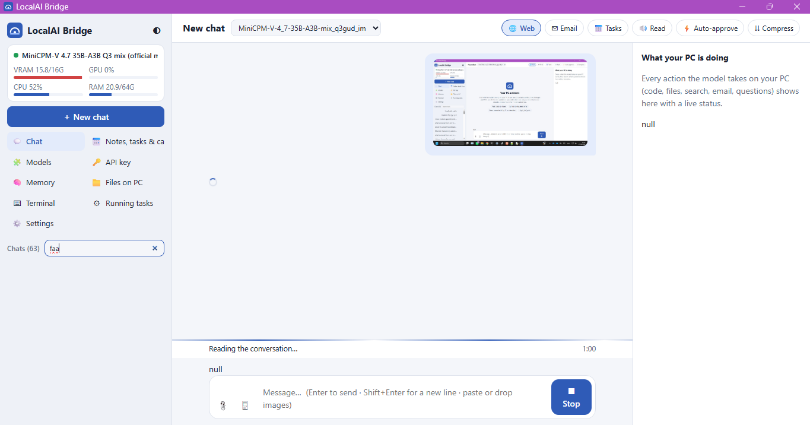

# LocalAI Bridge Desktop (Windows)

The phone app's features on a Windows laptop or PC, laid out for a big screen: chats on the left, the conversation in
the middle, and what the PC is doing (steps, plan, context) on the right.

**Download:** `LocalAI-Bridge-Desktop.exe` (one file, about 8 MB, no install). It opens in its own window using
Microsoft Edge's app mode, which is built into Windows 10 and 11.

## Connect

- **On the PC that runs the server:** start the exe and click **Connect to the server on this PC**.
- **From another laptop:** on the PC, open the server's pairing page (`http://127.0.0.1:8766/pair`) and copy the
  **pairing code** (or the URL and the access token). Paste it into the desktop app's connect screen.

## Features

| | |
|---|---|
| Chat | Streaming replies, thinking, code blocks with Copy, tables, Arabic / English text direction |
| Tools | Every action the model takes, with its output; approval window for code, files, sending email and Google events |
| See every step | Live list of what the model does on the PC (now / waiting / done / failed), or its own plan |
| Choices | Buttons when the model asks you to decide; tap-to-answer chips for options listed in a reply |
| Attachments | Drag and drop or paste images and files, PC screenshot |
| Edit / regenerate | Edit a sent message (the chat continues from there), regenerate the last reply, compress long chats |
| Read aloud | Arabic and English, detected per sentence (Windows / Edge voices), per reply or automatic |
| Access switches | Web, Email, Tasks & calendar, Auto-approve in the chat header (Email and Tasks off by default) |
| Models | Load, switch, reload, unload with tuned presets; live VRAM / GPU / CPU / RAM in the sidebar |
| API key | OpenAI-format URL + key for the loaded model, refresh / turn off, curl and Python examples |
| Notes, tasks & calendar | Tasks with descriptions and date-time pickers, notes, calendar (+ Google Calendar) |
| Email | Gmail folders, search, load more, explain an email, AI draft replies, edit / AI-edit / send drafts |
| From email | Scan all email of a period for tasks and emails that need your reply; add or dismiss |
| Memory | Search by meaning, categories, edit, forget, auto-remember switch |
| Files, terminal, running tasks | Browse / upload / download PC files, run code, stop chats and processes |

## How it works

`LocalAI-Bridge-Desktop.py` serves the UI in `ui/` on `127.0.0.1` and forwards `/api/*` to the LocalAI Bridge server
with the access token, so the token never reaches the page. A random key handed to the window at start stops other
programs and web pages on the computer from using it. Settings are kept in `%APPDATA%\LocalAI Bridge Desktop`.

Build the exe: `python make_icon.py` then
`pyinstaller --onefile --noconsole --name LocalAI-Bridge-Desktop --icon icon.ico --add-data "ui;ui" LocalAI-Bridge-Desktop.py`.
