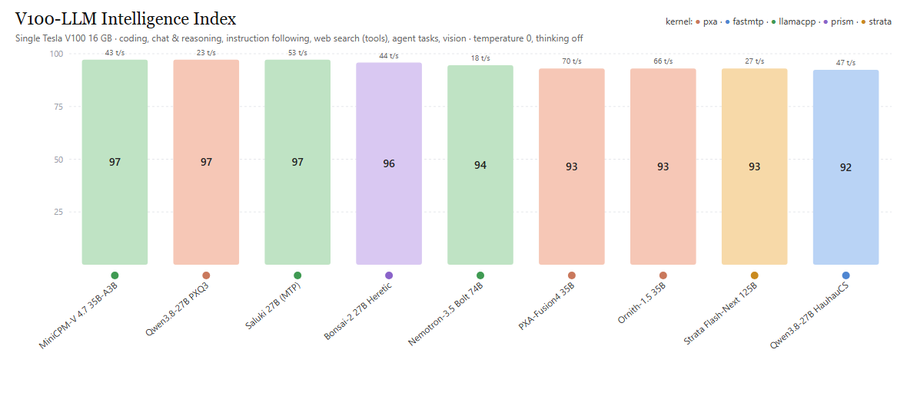

# V100-LLM leaderboard

| # | Model | Kernel | Size (GB) | Gen tok/s | Prompt tok/s (short) | Coding | Chat & reasoning | Instructions | Web search | Agent | Vision | Overall |
|---|---|---|---|---|---|---|---|---|---|---|---|---|
| 1 | MiniCPM-V 4.7 35B-A3B IQ3_XS | llamacpp | 14.5 | 42.7 | 115 | 100 | 83 | 100 | 100 | 100 | 100 | **97.2** |
| 2 | Qwen3.8-27B PXQ3 | pxa | 12.4 | 22.8 | 97 | 100 | 83 | 100 | 100 | 100 | 100 | **97.2** |
| 3 | Underdog Saluki 27B (Qwen3.8 2-bit, MTP) | llamacpp | 8.3 | 52.9 | 84 | 100 | 83 | 100 | 100 | 100 | 100 | **97.2** |
| 4 | Ternary-Bonsai-2-27B Uncensored Heretic | prism | 7.2 | 44.1 | 133 | 100 | 75 | 100 | 100 | 100 | 100 | **95.8** |
| 5 | NVIDIA Nemotron-3.5-Bolt-74B-A9B (2-bit) | llamacpp | 22.0 | 17.8 | 29 | 100 | 92 | 100 | 100 | 100 | 75 | **94.5** |
| 6 | PXA-Fusion4-35B-A3B PXQ2 | pxa | 11.2 | 69.8 | 478 | 83 | 75 | 100 | 100 | 100 | 100 | **93.0** |
| 7 | Ornith-1.5-35B-A3B PXQ2 | pxa | 11.2 | 65.9 | 362 | 83 | 75 | 100 | 100 | 100 | 100 | **93.0** |
| 8 | Strata: Qwen3.8-Flash-Next 125B IQ2_XS | strata | 63.3 | 27.4 | 44 | 100 | 75 | 100 | 83 | 100 | 100 | **93.0** |
| 9 | Qwen3.8-27B HauhauCS Aggressive IQ3_XS | fastmtp | 13.1 | 47.1 | 101 | 100 | 67 | 88 | 100 | 100 | 100 | **92.4** |
