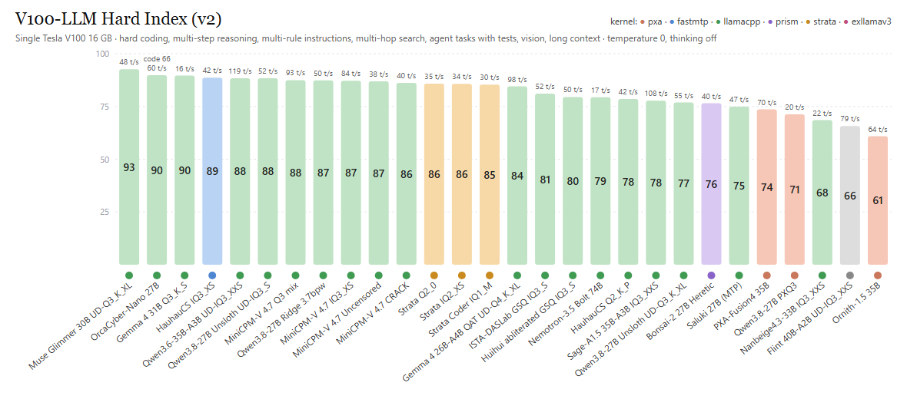

# V100-LLM leaderboard

| # | Model | Kernel | Size (GB) | Context (scored) | Max context on V100 | Gen tok/s | Prompt tok/s (short) | Coding | Reasoning | Instructions | Web search | Agent | Vision | Long context | Overall |
|---|---|---|---|---|---|---|---|---|---|---|---|---|---|---|---|
| 1 | Muse Glimmer 30B UD-Q3_K_XL (Meta, dense, vision) | llamacpp | 15.0 | 32k | 262k | 48.1 | 591 | 81 | 100 | 92 | 75 | 100 | 100 | 100 | **92.6** |
| 2 | OrcaCyber-Nano-1.0 27B Mix-13G (MTP built in) | llamacpp | 13.0 | 32k | 262k | 60 (code 66) | 501 | 88 | 95 | 58 | 100 | 100 | 88 | 100 | **89.8** |
| 3 | Gemma 4 31B Q3_K_S (Google, dense, vision) | llamacpp | 13.2 | 32k | 64k | 16.3 | 318 | 94 | 100 | 75 | 100 | 83 | 75 | 100 | **89.6** |
| 4 | Qwen3.8-27B HauhauCS Aggressive IQ3_XS | fastmtp | 13.1 | 24k | 120k | 42.2 | 387 | 88 | 95 | 50 | 100 | 100 | 88 | 100 | **88.6** |
| 5 | Qwen3.6-35B-A3B UD-IQ3_XXS (MTP built in, vision) | llamacpp | 14.1 | 64k | 262k | 119.3 | 478 | 94 | 100 | 50 | 88 | 100 | 88 | 100 | **88.4** |
| 6 | Qwen3.8-27B Unsloth UD-IQ3_S (MTP) | llamacpp | 13.4 | 32k | 262k | 52.1 | 460 | 94 | 100 | 50 | 100 | 100 | 75 | 100 | **88.4** |
| 7 | MiniCPM-V 4.7 35B-A3B Q3 mix (official mix_q3gud_im) | llamacpp | 15.5 | 128k | 262k | 93.4 | 467 | 88 | 100 | 50 | 88 | 100 | 88 | 100 | **87.5** |
| 8 | Qwen3.8-27B Ridge 3.7bpw (MTP) | llamacpp | 12.6 | 32k | 192k | 49.6 | 478 | 88 | 95 | 42 | 100 | 100 | 88 | 100 | **87.4** |
| 9 | MiniCPM-V 4.7 35B-A3B IQ3_XS | llamacpp | 14.5 | 192k | 262k | 84.4 | 535 | 94 | 100 | 42 | 88 | 100 | 88 | 100 | **87.2** |
| 10 | MiniCPM-V 4.7 35B-A3B Uncensored Q4_K-IQ4_XS (AtomicChat) | llamacpp | 20.1 | 262k | 262k | 38.3 | 376 | 88 | 100 | 33 | 100 | 100 | 88 | 100 | **86.9** |
| 11 | MiniCPM-V 4.7 35B-A3B CRACK Q4_K_M (dealignai) | llamacpp | 22.6 | 262k | 262k | 40.5 | 340 | 88 | 95 | 33 | 100 | 100 | 88 | 100 | **86.2** |
| 12 | Strata: Qwen3.8-Flash-Next 125B Q2_0 | strata | 66.4 | 262k | 262k | 34.8 | 1207 | 94 | 90 | 42 | 88 | 100 | 88 | 100 | **85.8** |
| 13 | Strata: Qwen3.8-Flash-Next 125B IQ2_XS | strata | 68.0 | 262k | 262k | 34.1 | 1163 | 88 | 100 | 50 | 88 | 100 | 75 | 100 | **85.7** |
| 14 | Strata: Qwen3.8-Flash-Next 125B Coder IQ1_M | strata | 58.4 | 262k | 262k | 29.7 | 1247 | 94 | 100 | 42 | 88 | 100 | 75 | 100 | **85.4** |
| 15 | Gemma 4 26B-A4B QAT UD-Q4_K_XL (Google, MoE, vision) | llamacpp | 14.2 | 32k | 262k | 97.9 | 1249 | 88 | 100 | 75 | 75 | 67 | 88 | 100 | **84.5** |
| 16 | Qwen3.8-27B ISTA-DASLab GSQ-RCO-IQ3_S (MTP) | llamacpp | 12.1 | 32k | 192k | 52.4 | 480 | 94 | 95 | 42 | 100 | 100 | 88 | 50 | **81.1** |
| 17 | Qwen3.8-27B Huihui abliterated GSQ-RCO-IQ3_S (MTP) | llamacpp | 12.1 | 32k | 192k | 50.2 | 471 | 69 | 100 | 50 | 100 | 100 | 88 | 50 | **79.5** |
| 18 | NVIDIA Nemotron-3.5-Bolt-74B-A9B (2-bit) | llamacpp | 22.0 | 262k | 262k | 16.7 | 277 | 75 | 85 | 58 | 100 | 100 | 88 | 50 | **79.4** |
| 19 | Qwen3.8-27B HauhauCS Aggressive Q2_K_P (long context) | llamacpp | 10.7 | 160k | 160k | 41.6 | 326 | 75 | 95 | 42 | 100 | 100 | 88 | 50 | **78.5** |
| 20 | Sage-A1.5 35B-A3B IQ3_XXS (InternScience, MoE, MTP, vision) | llamacpp | 14.1 | 64k | 262k | 108.3 | 482 | 81 | 100 | 50 | 25 | 100 | 88 | 100 | **77.7** |
| 21 | Qwen3.8-27B Unsloth UD-Q3_K_XL (DFlash2) | llamacpp | 14.3 | 32k | 32k | 55.4 | 508 | 94 | 90 | 42 | 100 | 100 | 62 | 50 | **76.9** |
| 22 | Ternary-Bonsai-2-27B Uncensored Heretic | prism | 7.2 | 262k | 262k | 39.5 | 363 | 56 | 100 | 42 | 100 | 100 | 88 | 50 | **76.5** |
| 23 | Underdog Saluki 27B (Qwen3.8 2-bit, MTP) | llamacpp | 8.3 | 262k | 262k | 46.8 | 351 | 62 | 95 | 42 | 88 | 100 | 88 | 50 | **74.9** |
| 24 | PXA-Fusion4-35B-A3B PXQ2 | pxa | 11.2 | 16k | 16k | 70.0 | 2384 | 38 | 90 | 25 | 88 | 100 | 75 | 100 | **73.6** |
| 25 | Qwen3.8-27B PXQ3 | pxa | 12.4 | 8k | 8k | 19.8 | 573 | 75 | 95 | 42 | 100 | 100 | 88 | 0 | **71.3** |
| 26 | Nanbeige4.3-33B IQ3_XXS (Nanbeige, dense) | llamacpp | 13.1 | 48k | 48k | 22.0 | 282 | 69 | 90 | 33 | 88 | 100 | 0 | 100 | **68.5** |
| 27 | Flint 40B-A2B UD-IQ3_XXS (Recursive, MoE, coding) | llamacpp-b11804 | 14.5 | 64k | 262k | 78.6 | 381 | 69 | 95 | 33 | 62 | 100 | 0 | 100 | **65.7** |
| 28 | Ornith-1.5-35B-A3B PXQ2 | pxa | 11.2 | 16k | 16k | 64.1 | 2333 | 50 | 85 | 33 | 100 | 83 | 75 | 0 | **60.9** |
